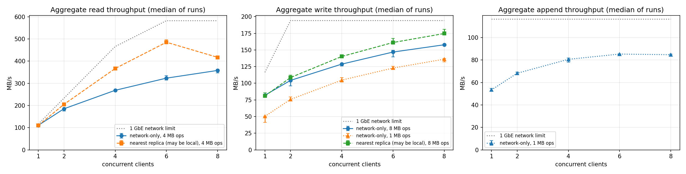
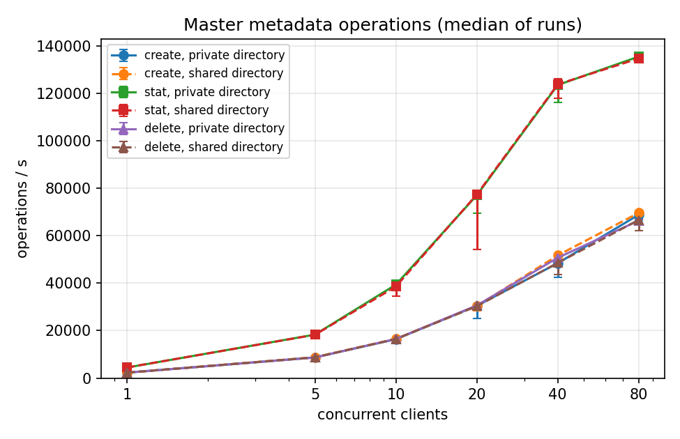

# Benchmark results

Measured on a 6-node SLURM cluster (1 GbE), October 2026. Per-client raw CSVs, summary CSVs and the plots are in [results/](results/), all produced by [`analyze.py`](analyze.py) from the job outputs. Nothing here is estimated or extrapolated.

## Setup

6 nodes of a SLURM cluster: 1 master node and 5 chunkserver nodes, all on 1 Gb/s Ethernet. Clients are placed round-robin over all 6 nodes. 64 MiB chunks, 3 replicas, node-local disk. The full method, including how the network limits are derived, is in [METHODOLOGY.md](METHODOLOGY.md).

- **Network baseline (measured in each job):** one TCP stream 117.8 MB/s. Per NIC, with all 6 nodes sending and receiving at once, **116.5 MB/s** (*B*). The limits in the tables are derived from *B*.
- **Disk baseline:** `dd` 2 GiB with fdatasync, 227–442 MB/s per chunkserver node.
- **Aggregate throughput** = total bytes / (last client end − first client start). MB = 10^6 bytes. Each configuration was run 3 times, and the table reports the median and the min–max.
- **Client modes:**
  - `avoid` (network-only): a client never reads from, or pushes first to, a replica on its own node, so every byte crosses the network.
  - `local`: the normal nearest-replica policy, which may use loopback.

## Read throughput (§6.1.1)

Each client reads 2 GiB as random 4 MiB regions of a 16 GiB dataset.

| op | client mode | op size | clients | runs | median MB/s | min–max | network limit | % of limit |
|---|---|---|---:|---:|---:|---|---:|---:|
| read | avoid | 4M | 1 | 3 | 110.7 | 110.0–111.0 | 116.5 | 95% |
| read | avoid | 4M | 2 | 3 | 185.2 | 175.0–186.2 | 233.0 | 80% |
| read | avoid | 4M | 4 | 3 | 268.6 | 265.3–270.1 | 466.0 | 58% |
| read | avoid | 4M | 6 | 3 | 323.4 | 314.8–335.1 | 582.5 | 56% |
| read | avoid | 4M | 8 | 3 | 358.2 | 347.1–363.3 | 582.5 | 61% |
| read | local | 4M | 1 | 3 | 110.3 | 110.0–110.4 | – |  |
| read | local | 4M | 2 | 3 | 205.3 | 204.5–207.9 | – |  |
| read | local | 4M | 4 | 3 | 366.8 | 359.0–369.9 | – |  |
| read | local | 4M | 6 | 3 | 485.3 | 480.8–495.9 | – |  |
| read | local | 4M | 8 | 3 | 417.3 | 416.9–419.1 | – |  |

## Write throughput (§6.1.2)

Each client writes 1 GiB to its own new file. Every byte is written to 3 replicas through a pipelined chain.

| op | client mode | op size | clients | runs | median MB/s | min–max | network limit | % of limit |
|---|---|---|---:|---:|---:|---|---:|---:|
| write | avoid | 8M | 1 | 3 | 82.1 | 81.9–83.7 | 116.5 | 70% |
| write | avoid | 8M | 2 | 3 | 104.3 | 96.1–106.2 | 194.2 | 54% |
| write | avoid | 8M | 4 | 3 | 128.8 | 125.8–129.9 | 194.2 | 66% |
| write | avoid | 8M | 6 | 3 | 146.9 | 139.8–149.4 | 194.2 | 76% |
| write | avoid | 8M | 8 | 3 | 157.8 | 156.4–158.7 | 194.2 | 81% |
| write | avoid | 1M | 1 | 3 | 50.3 | 41.2–50.5 | 116.5 | 43% |
| write | avoid | 1M | 2 | 3 | 75.8 | 73.7–79.6 | 194.2 | 39% |
| write | avoid | 1M | 4 | 3 | 104.7 | 101.9–108.6 | 194.2 | 54% |
| write | avoid | 1M | 6 | 3 | 122.8 | 122.3–125.3 | 194.2 | 63% |
| write | avoid | 1M | 8 | 3 | 136.2 | 132.3–136.9 | 194.2 | 70% |
| write | local | 8M | 1 | 3 | 80.9 | 80.2–85.6 | – |  |
| write | local | 8M | 2 | 3 | 108.6 | 108.2–112.4 | – |  |
| write | local | 8M | 4 | 3 | 140.2 | 139.4–142.1 | – |  |
| write | local | 8M | 6 | 3 | 161.2 | 160.0–167.4 | – |  |
| write | local | 8M | 8 | 3 | 174.7 | 173.5–181.3 | – |  |

## Record append throughput (§6.1.3)

N clients append 1 MiB records to **one shared file**: 512 MiB per client. All appends to a chunk go through its single primary, so the limit is one NIC (*B*) whatever N is.

| op | client mode | op size | clients | runs | median MB/s | min–max | network limit | % of limit |
|---|---|---|---:|---:|---:|---|---:|---:|
| append | avoid | 1M | 1 | 3 | 53.4 | 52.3–54.8 | 116.5 | 46% |
| append | avoid | 1M | 2 | 3 | 68.2 | 67.0–69.2 | 116.5 | 59% |
| append | avoid | 1M | 4 | 3 | 80.7 | 78.2–81.8 | 116.5 | 69% |
| append | avoid | 1M | 6 | 3 | 85.3 | 84.8–85.6 | 116.5 | 73% |
| append | avoid | 1M | 8 | 3 | 84.7 | 83.2–85.4 | 116.5 | 73% |

After every run, the whole file was scanned and every record was checked: 15 runs, 63 writers, **32,256 records**, **0 missing, 0 duplicated, 0 corrupt**.

## Recovery (§6.2.2)

20 GiB of data (10 files × 2 GiB = 21.5 GB; 320 chunks, 64.4 GB with replicas). `kill -9` the chunkservers on 2 of the 5 nodes, chosen at random. The time runs until every chunk has 3 live replicas again. Afterwards, every replica of every chunk was fetched directly from its chunkserver and compared byte for byte.

| job | killed nodes | chunks | chunks under-replicated | clones | kill → detected | detected → 3× | **kill → 3×** | clone rate | verified | problems |
|---|---|---:|---:|---:|---:|---:|---:|---:|---:|---:|
| 103666 | node05, node04 | 320 | 258 | 382 | 4.7 s | 145.7 s | **150.4 s** | 176.0 MB/s | 64.4 GB, 960 replicas | 0 |
| 103667 | node02, node06 | 320 | 265 | 385 | 4.5 s | 148.1 s | **152.6 s** | 174.5 MB/s | 64.4 GB, 960 replicas | 0 |
| 103668 | node03, node04 | 320 | 303 | 383 | 4.9 s | 145.9 s | **150.8 s** | 176.2 MB/s | 64.4 GB, 960 replicas | 0 |
| **median** | | | | | **4.7 s** | **145.9 s** | **150.8 s** | **176.0 MB/s** | | **0** |

With 2 of 5 servers dead, every clone lands on the 3 survivors, so the network limit is 3*B* = 349.5 MB/s of ingress. Cloning ran at 176 MB/s, about 50 % of that. Each clone is also fsynced on install, and the per-server clone limit is 4.

## Snapshots vs. copying (§3.4)

Job 103684. One client on the master's node, with a dataset of 8 × 2 GiB files (17.2 GB, 256 chunks, 3 replicas). A snapshot copies only metadata and increments chunk reference counts. Data is copied later, chunk by chunk, on the first write to a shared chunk. The alternative, without snapshots, is to read the data through a client and write it back.

A snapshot must first revoke every outstanding lease on the source chunks (§3.4). Run 1 started right after the dataset was written, while the writers' 60 s leases were live. Runs 2 and 3 came minutes later and found none. The two cases are reported separately.

| operation | data | live leases | per-run times |
|---|---:|---|---|
| Snapshot one file (32 chunks) | 2.1 GB | yes (run 1) | 16.5 ms |
| Snapshot one file (32 chunks) | 2.1 GB | none (runs 2, 3) | 0.38 ms, 0.38 ms |
| Snapshot directory (8 files, 256 chunks) | 17.2 GB | yes (run 1) | 171.6 ms |
| Snapshot directory (8 files, 256 chunks) | 17.2 GB | none (runs 2, 3) | 0.50 ms, 0.50 ms |
| Snapshot directory of 1,000 one-chunk files | 4.1 MB | yes (written just before) | 323.4 ms |
| Snapshot directory of 1,000 one-chunk files | 4.1 MB | none (snapshotted again) | 1.35 ms, 2.12 ms |
| **Copy** one file through the client | 2.1 GB | – | 33.2 s, 32.5 s, 32.1 s (median 32.5 s, 66 MB/s) |
| **Copy** directory, 8 files in parallel | 17.2 GB | – | 167.2 s, 167.2 s, 167.3 s (median 167.2 s, 103 MB/s) |

- **Snapshot vs. copy.** Copying the 17.2 GB directory took 167 s. A snapshot of it took 0.5 ms, or 172 ms when it first had to revoke the leases left by the writes that had just finished.
- **Copy speed.** The directory copy reads and writes every byte through the client's single NIC, whose measured limit is *B* = 116.5 MB/s in each direction. The copy ran at 103 MB/s.
- **Revocation cost.** The master revokes each live lease with one RPC to its primary, one chunk at a time, and skips leases that have already expired. The snapshot holds the source chunk locks until every revocation has returned. With 1,000 single-chunk files that had all just been written, that took 323 ms, against 1.4–2.1 ms with no leases. The number of leases revoked in each run was not recorded.

### Cost of copy-on-write

A 4 KiB write at the start of every chunk of 3 snapshotted files (96 chunks), each followed by a rewrite of the same bytes. For comparison, the same was done on the 3 client copies of the first file, whose chunks are not shared.

| write | writes | median | min–max |
|---|---:|---:|---|
| First write to a chunk shared with a snapshot (copy-on-write) | 96 | **357 ms** | 233–691 ms |
| First write to an unshared chunk (lease lapsed, new lease granted) | 96 | 4.8 ms | 3.3–16.9 ms |
| Rewrite under a lease the client already holds | 192 | 2.5 ms | 1.5–9.5 ms |

The first write to a shared chunk waits while its 3 replicas each copy the 64 MiB chunk on their local disk (§3.4). The 3 copies run in parallel, and each includes a disk read and an fsync. It cost about 350 ms more than the first write to an unshared chunk, paid once per chunk. Later writes to the new chunk cost the same as any other write.

### Snapshot contents

- **Patched sources.** After the copy-on-write writes, every byte of the 3 patched source files (6.4 GB) was read back: the patch at each chunk start, and the original bytes everywhere else.
- **Snapshots of the patched files.** Every snapshot of them still held the original bytes at every patched offset. 0 problems.
- **Directory snapshot.** One full snapshot of the directory (17.2 GB) was read back by 6 verifiers and compared byte for byte with the original dataset. 0 problems.

## Master metadata operations

Job 103685. N clients (1–80) each create, then stat, then delete empty files. The clients run as min(N, 5) processes on the 5 chunkserver nodes, never on the master's node, with one gRPC client per thread. Every create and delete is written to the op log and fsynced before it is acknowledged; concurrent mutations share an fsync (group commit). The master's job step has 8 CPUs. Throughput is total ops / (last client end − first client start), the median of 3 runs. Latencies are per operation, as seen by the client. All 36 configurations ran with **0 errors**.

| clients | create ops/s | stat ops/s | delete ops/s | create p50 / p99 | stat p50 / p99 |
|---:|---:|---:|---:|---:|---:|
| 1 | 2,281 | 4,443 | 2,286 | 437 / 496 µs | 216 / 300 µs |
| 5 | 8,707 | 18,312 | 8,671 | 568 / 900 µs | 231 / 606 µs |
| 10 | 16,375 | 39,355 | 16,479 | 604 / 952 µs | 235 / 475 µs |
| 20 | 30,466 | 77,018 | 30,600 | 591 / 1,383 µs | 231 / 671 µs |
| 40 | 48,415 | 123,444 | 50,688 | 700 / 3,911 µs | 268 / 1,082 µs |
| 80 | **68,802** | **135,403** | **66,324** | 949 / 5,716 µs | 479 / 3,105 µs |

These are the private-directory numbers: each client works in its own directory. With all N clients in **one shared directory**, the medians differed from these by −4.3 % to +6.8 %, with no consistent direction: 69,602 creates/s, 134,632 stats/s and 66,632 deletes/s at N = 80. The full table, with min–max over runs and both layouts, is in [results/meta_summary.csv](results/meta_summary.csv).

- **Logged mutations scale with clients.** A single client is bound by one round trip plus one fsync per create. The master disk does about 5,270 synchronous 4 KiB writes/s (`dd oflag=dsync`, measured in the same job). 80 clients reached 68,802 creates/s, so the group commit puts many creates into each fsync.
- **Every mutation was logged.** The final op log position was 2,400,524: 3 runs × 2 layouts × 400,000 creates and deletes = 2,400,000, plus the directories created.
- **Namespace locks do not limit throughput.** A create read-locks the parent directory and write-locks the new path (§4.1), so creates in one shared directory can proceed in parallel. They ran as fast as creates in private directories.
- **Stat** is not logged and peaked at 135,403 ops/s at N = 80, up from 123,444 at N = 40. We did not profile what limits it.
- **For scale:** §6.2.4 of the paper reports production masters handling 200–500 ops/s. Our master is a different implementation on different hardware, so this is context, not a comparison.

## Data integrity

- At the end of each throughput job, the dataset written at its start was read back and verified: 17.2 GB in each read job, 0.54 GB in the write and append jobs. 0 problems in all 4 jobs.
- After each recovery: 960/960 replicas were identical, with 0 problems, in all 3 runs.
- Appends: 32,256/32,256 records were present exactly once.
- Snapshots: 6.4 GB of patched source files and every patched offset of 6 snapshots were checked, and one 17.2 GB directory snapshot was read back in full. 0 problems.

## Caveats

1. **Reads come from the page cache, not disk.** The nodes have 186–502 GB of RAM and the dataset is 16 GiB, so read numbers measure the network and GFS, not the disks. The paper's numbers were disk-backed.
2. **Scale.** 5 chunkservers on 1 GbE, against the paper's 16 chunkservers and 16 clients. Compare the numbers with the network-limit column, not with the paper's figures.
3. **Shared cluster.** Other users' jobs ran on some nodes during these runs. The min–max ranges include that.
4. **Clients share nodes with chunkservers.** In `local` mode, reads served by a co-located chunkserver use loopback, so those numbers can exceed the network limit. With N = 8, two nodes host two clients each. Local-mode reads fell from N = 6 to N = 8; we did not investigate why.
5. **Software version.** The throughput, append and recovery jobs (103663–103671) used commit 49596ce: core GFS plus record append. Snapshots, lazy GC, namespace locks and rebalancing came later and are not part of those runs. The snapshot and metadata jobs (103684, 103685) used commit 0cc5ccb, which has all of them. It also has the fix for a chunkserver bug found while preparing those jobs: overwriting part of a chunk re-checksummed the rest of it (f99c34d). The earlier jobs' writes were all appends to a chunk's end or whole-chunk clones, which that bug did not affect.
6. **Short metadata phases.** At N ≥ 40, a phase lasts 0.3–1.3 s. All client processes start at a common wall-clock time: across those runs, their start times differed by at most 1.2 ms. The measured interval runs from the first start to the last end.
